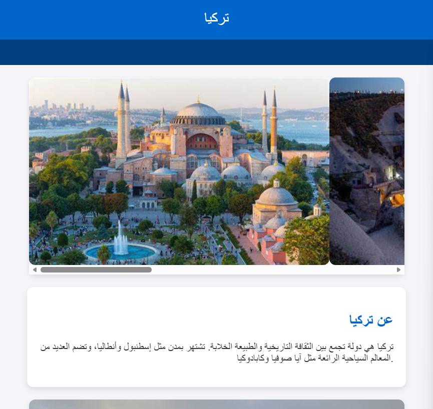
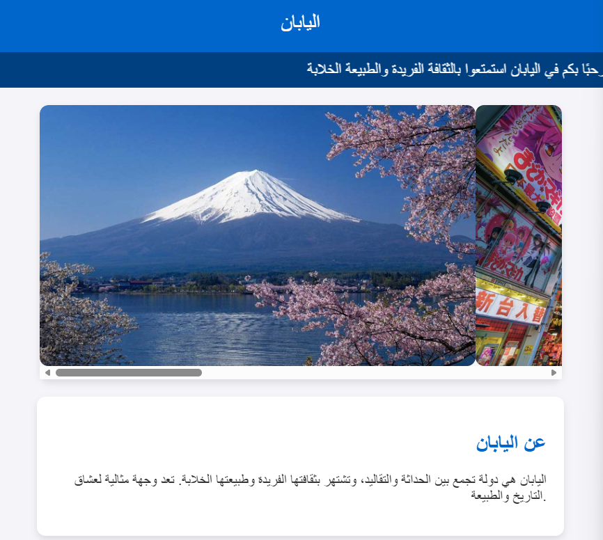
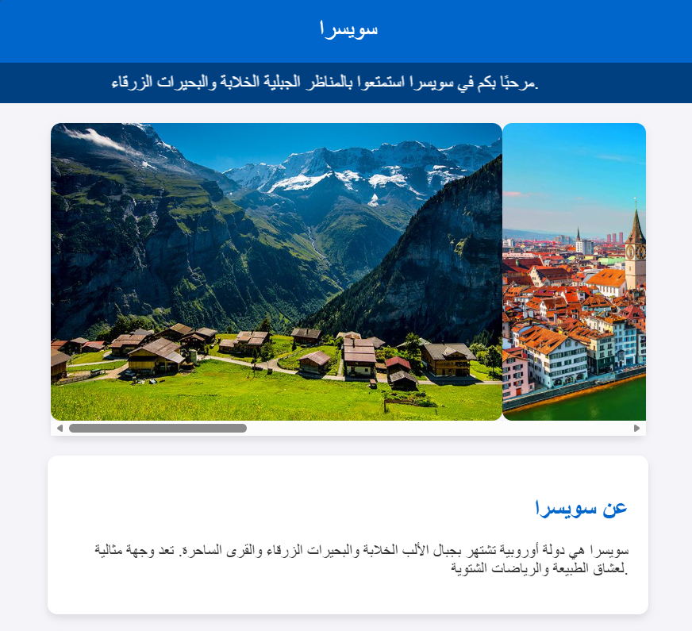
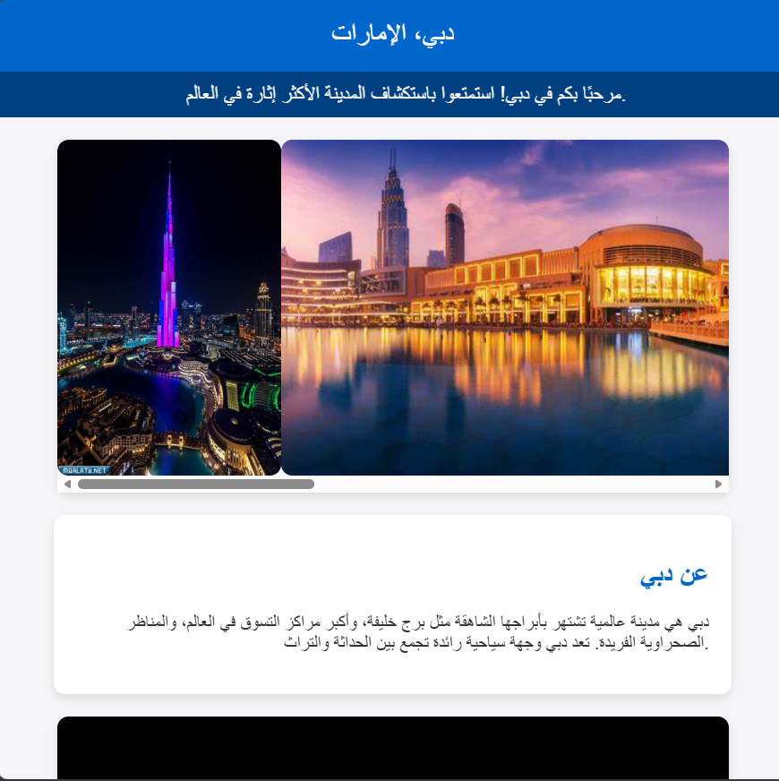
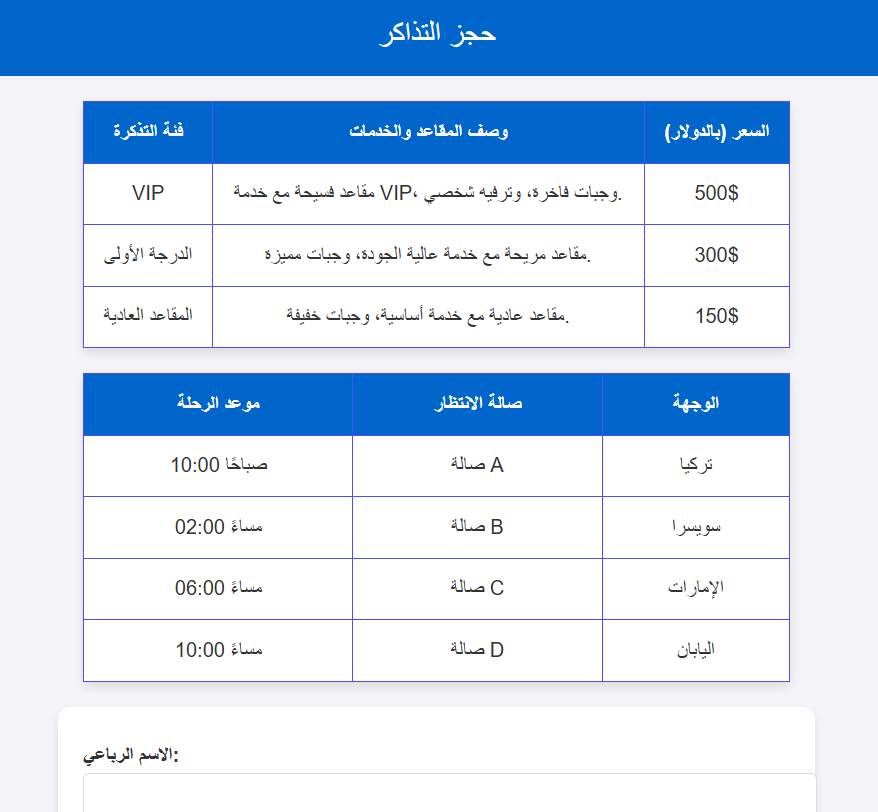

# مشروع حجز تذاكر لجميع الدول

موقع ويب سياحي وتعريفي لـ حجز التذاكر واستعراض الوجهات السياحية يضم صفحات تعريفية بعدة وجهات (تركيا، اليابان، سويسرا، دبي/الإمارات) مع جدول لأسعار وخدمات المقاعد، صالات الانتظار، ومواعيد الرحلات.

## أبرز أقسام ومميزات الموقع
- صفحة تركيا: استعراض المعالم التاريخية والطبيعية في تركيا مثل إسطنبول وأنطاليا وكابادوكيا مع معرض صور.
- صفحة اليابان: إبراز المزيج بين الحداثة والتقاليد والطبيعة الخلابة في اليابان مع صور تعريفية.
- صفحة سويسرا: عرض طبيعة جبال الألب والبحيرات والقرى السويسرية مع صور متنوعة.
- صفحة دبي (الإمارات): التعريف بأبرز معالم دبي مثل برج خليفة ومراكز التسوق والمناظر الصحراوية.
- صفحة حجز التذاكر: جدول يوضح فئات المقاعد والخدمات والأسعار (500$، 300$، 150$)، بالإضافة إلى جدول الوجهات، صالات الانتظار، ومواعيد الرحلات.

## لقطات من الموقع

### 1. صفحة تركيا
تعرض نبذة عن تركيا ومعالمها التاريخية والطبيعية مع معرض صور.

### 2. صفحة اليابان
تستعرض ثقافة اليابان وطبيعتها الخلابة مع صور للمعالم والمشاهد السياحية.

### 3. صفحة سويسرا
تبرز جمال الطبيعة السويسرية من جبال وبحيرات وقرى مع معرض الصور.

### 4. صفحة دبي (الإمارات)
تعرض معالم دبي الحديثة والصحراوية مع صور للواجهة السياحية.

### 5. صفحة حجز التذاكر
تضم جدول أسعار وخدمات فئات المقاعد وجدول الوجهات وصالات الانتظار ومواعيد الرحلات.

## محتويات المشروع
- صفحات HTML الخاصة بالوجهات وحجز التذاكر (`turkey.html`, japan.html, switzerland.html, dubai.html, `booking.html`).
- ملفات صور (`JPG`) ومقاطع فيديو (`MP4`) داعمة لعرض الوجهات.
